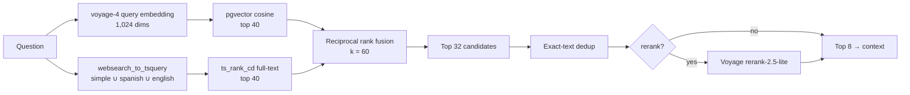

# hybrid-rag-bench

A small, reproducible **retrieval** benchmark for a hybrid RAG pipeline in TypeScript: pgvector semantic search plus Postgres full-text search, fused with reciprocal rank fusion (RRF), optionally reranked with Voyage `rerank-2.5-lite`.

It runs entirely in-process on [PGlite](https://pglite.dev) (WASM Postgres) with the pgvector extension, so there is no database to set up. It measures what lands in the 8-passage context window. It does **not** generate or grade answers.

The pipeline is extracted from the RAG pipeline of a private agent platform I'm building (currently an invite-only beta). This repository keeps the retrieval core and its benchmark methodology and removes everything product-specific (see [How this differs from the source system](#how-this-differs-from-the-source-system)).

## Pipeline



| Stage | Detail |
| --- | --- |
| Chunking | Section-aware character chunker (2,400 chars, 240 overlap, break on paragraph/space). SciFact uses 600-char chunks, no overlap; see [SciFact](#scifact). |
| Semantic | `ORDER BY embedding <=> $q, id LIMIT 40`. Exact scan, no ANN index, so no approximation enters the measurement. |
| Full-text | `tsvector` = `simple` ∪ `spanish` ∪ `english` configurations. The query is the OR of three `websearch_to_tsquery` calls, ranked by `ts_rank_cd`, top 40. |
| Fusion | RRF: `score = Σ 1/(60 + rank)`, 1-based ranks, ties broken by id. |
| Candidates | Top 32 fused results, then exact-text duplicates removed (the first occurrence is kept; near-duplicates stay, since they can carry different facts). |
| Rerank | `rerank-2.5-lite` scores every remaining candidate; ties keep hybrid order. Skipped when there are 0–1 candidates. |
| Context | Top 8. |

### Modes compared in every run

| Mode | Context = |
| --- | --- |
| `semantic-only` | pgvector top 32 → dedup → top 8 |
| `fts-only` | full-text top 32 → dedup → top 8 |
| `hybrid-rrf` | RRF top 32 → dedup → top 8 |
| `hybrid-rrf+rerank` | RRF top 32 → dedup → rerank → top 8 |
| `hybrid-rrf+rerank-preserve8` | Every distinct passage from the hybrid top 8 is kept; the reranker only reorders them and fills slots freed by duplicates. This is the policy the source system adopted after pure reranking lost a source on a comparison question (there, reranking is implemented but off by default). It reuses the same rerank call, so it costs nothing extra. |

### Metrics

All metrics are reported per split (development / held-out / regression), never pooled.

- **Hit@8, Recall@8, MRR@8, nDCG@8** over *evidence ids*, with binary relevance. Evidence repeated in the context (two chunks of one abstract, or an exact-duplicate document) earns credit once and still uses up a slot.
- **Candidate recall@32**: recall of the deduplicated candidate list before the final cut. If it is below 1, the retrievers missed the evidence and no reranker can recover it. If it is 1 but Recall@8 is lower, the evidence was cut at the top-8 stage.
- **No-evidence questions** (nothing in the corpus answers them, or the only answer is in an ineligible document) are **excluded** from ranking metrics and listed separately, rather than being scored as perfect.
- **Ineligible passages returned** is a sanity check that documents marked inactive, revoked or not selected are filtered out. It must be 0.

Every run writes `runs/<dataset>/<timestamp>-<live|offline>/`:

- `report.json`: dataset SHA-256, model names, git revision and dirty flag, pipeline parameters, spend journal summary and per-question results for every mode. It stores no document text.
- `summary.md`: the tables below.
- `usage.json` (live runs only): every Voyage request with its reserved and settled cost.

The live reports used for the results below are committed in [`reports/`](reports/).

## Running it

Requires Node 22 and pnpm.

```sh
pnpm install
pnpm bench                       # offline, synthetic-coverage-v2
pnpm bench --original            # offline, original synthetic set
pnpm download:scifact            # fetch the public dataset (see licence below)
pnpm bench --dataset scifact

cp .env.example .env             # add VOYAGE_API_KEY, or export it
pnpm bench --live                                   # live, synthetic-coverage-v2
pnpm bench --live --dataset synthetic-original
pnpm bench --live --dataset scifact

pnpm test && pnpm typecheck
```

**Offline mode** uses a deterministic token-hash "embedding" and a token-overlap stand-in for the reranker, so CI can exercise the SQL, fusion, dedup and metrics code without a key. **Its numbers do not measure semantic retrieval or reranking quality** and are labelled as such in every report.

**Live mode** uses Voyage `voyage-4` (1,024-dim) embeddings and `rerank-2.5-lite`.

- **Hard spend cap:** each request reserves a conservative cost ceiling first (UTF-8 bytes + 64 per input, priced as tokens). If the run's committed spend plus that ceiling would exceed `--cap-usd`, the request is refused before it is sent. The default cap is **$0.25 per run**. Successful requests settle to the token usage Voyage reports.
- **No silent retries:** any HTTP error, timeout or malformed response aborts the run. If the charge is uncertain (network error, 5xx), its reservation is kept in the spend total.
- **Pacing:** the defaults (`--rpm 3 --tpm 9000`) fit Voyage's limits for accounts without a payment method (3 requests/min, 10K tokens/min). With a paid tier, raise them.
- **Embedding cache:** embeddings are cached in `.cache/` (keyed by model, dimension, input type and text), so a re-run does not pay twice. Each report states how many vectors came from the cache, and `--no-cache` disables it. Rerank calls are never cached.

## Datasets

| Dataset | Docs | Questions (dev / held-out / regression) | No-evidence | Language |
| --- | ---: | --- | ---: | --- |
| `synthetic-coverage-v2` (default) | 52 | 6 / 8 / 2 | 3 | Spanish docs; Spanish + English questions |
| `synthetic-original` (`--original`) | 41 | 9 / 12 / – | 4 | same |
| `scifact` (default subset) | 300 abstracts | 25 / 25 / – | 0 | English |

**Synthetic corpora.** Fictional appliance-support documents (warranties, maintenance intervals, part codes, delivery times) with deliberate traps:

- a superseded policy marked inactive;
- an exact duplicate document;
- 20 near-identical catalogue distractors;
- pairs of products with near-identical policies;
- two- and four-source comparison questions;
- planted fake "secrets" in ineligible documents.

Every product, place, code and number is invented, and there are no real people, customers or companies. The splits were fixed before the original private live runs. The `synthetic-original` held-out questions were inspected during that earlier development, so treat them as regression evidence. The v2 held-out questions had been run once before and were not tuned on. Nothing in this repository was tuned on any split.

<a id="scifact"></a>**SciFact.** A deterministic subset of the BEIR SciFact test split ([Wadden et al., EMNLP 2020](https://aclanthology.org/2020.emnlp-main.609/); BEIR packaging by [Thakur et al., 2021](https://arxiv.org/abs/2104.08663)):

- 50 claims, sampled by hashing the query id with a fixed seed and alternated between dev and held-out;
- all 55 relevant abstracts plus 245 random distractors.

SciFact is licensed **CC BY-NC 2.0**, so it is not committed here. `pnpm download:scifact` fetches it into `data/external/scifact/` from pinned Hugging Face revisions and verifies pinned SHA-256 hashes. The download is treated as untrusted data and never executed.

Because the distractors are random rather than hard negatives and the corpus is 300 abstracts rather than 5,183, these numbers are **not comparable to published BEIR SciFact nDCG@10**. Abstracts are chunked at 600 characters so that a 32-candidate rerank request stays under the free-tier 10K tokens/minute limit. Use `--scifact-queries`/`--scifact-corpus 0` for larger runs on a paid tier.

## Results

Live runs on **2026-11-20**. Code revision `a995099`, clean tree. Embeddings `voyage-4` (1,024 dims), reranker `rerank-2.5-lite`, one sample per question and mode. Full per-question results are in [`reports/`](reports/). Values are rounded to three decimals; the JSON reports hold the unrounded figures. *n* is the number of answerable questions in the split, and no-evidence questions are excluded.

**Cost.** Voyage list price, estimated from the token usage Voyage reported. Total: **$0.011727** across 111 requests and no uncertain reservations:

| Run | Requests | Embedding tokens | Rerank tokens | Spend | Wall-clock (mostly free-tier pacing) |
| --- | ---: | ---: | ---: | ---: | ---: |
| synthetic-coverage-v2 | 18 | 3,260 | 42,400 | $0.001055 | 484 s |
| synthetic-original | 22 | 251 | 50,865 | $0.001046 | 508 s |
| scifact-q50-c300 | 71 | 99,377 | 181,610 | $0.009626 | 4,078 s |

`synthetic-original` reused 43 of its 62 embeddings from the local cache, because its documents are a subset of v2. Only its new query embeddings were paid for, which is why its embedding tokens are so low. The account used has no payment method, so Voyage's free-token allowance may mean nothing was actually billed. The figures above are list-price estimates and do not assume free credits.

### synthetic-coverage-v2

| Split (n) | Mode | Hit@8 | Recall@8 | MRR@8 | nDCG@8 | Cand. recall@32 |
| --- | --- | ---: | ---: | ---: | ---: | ---: |
| development (5) | semantic-only | 1.000 | 1.000 | 1.000 | 1.000 | 1.000 |
| | fts-only | 0.000 | 0.000 | 0.000 | 0.000 | 0.000 |
| | hybrid-rrf | 1.000 | 1.000 | 1.000 | 1.000 | 1.000 |
| | hybrid-rrf+rerank | 1.000 | 1.000 | 1.000 | 1.000 | 1.000 |
| | +rerank-preserve8 | 1.000 | 1.000 | 1.000 | 1.000 | 1.000 |
| held-out (6) | semantic-only | 1.000 | 1.000 | 1.000 | 0.987 | 1.000 |
| | fts-only | 0.000 | 0.000 | 0.000 | 0.000 | 0.000 |
| | hybrid-rrf | 1.000 | 1.000 | 1.000 | 0.987 | 1.000 |
| | hybrid-rrf+rerank | 1.000 | 1.000 | 1.000 | 1.000 | 1.000 |
| | +rerank-preserve8 | 1.000 | 1.000 | 1.000 | 1.000 | 1.000 |
| regression (2) | semantic-only | 1.000 | 1.000 | 0.667 | 0.785 | 1.000 |
| | fts-only | 0.000 | 0.000 | 0.000 | 0.000 | 0.000 |
| | hybrid-rrf | 1.000 | 1.000 | 0.667 | 0.785 | 1.000 |
| | hybrid-rrf+rerank | 1.000 | **0.750** | 1.000 | 0.807 | 1.000 |
| | +rerank-preserve8 | 1.000 | 1.000 | 1.000 | 0.916 | 1.000 |

### synthetic-original

| Split (n) | Mode | Hit@8 | Recall@8 | MRR@8 | nDCG@8 | Cand. recall@32 |
| --- | --- | ---: | ---: | ---: | ---: | ---: |
| development (7) | semantic-only | 1.000 | 1.000 | 1.000 | 1.000 | 1.000 |
| | fts-only | 0.000 | 0.000 | 0.000 | 0.000 | 0.000 |
| | hybrid-rrf | 1.000 | 1.000 | 1.000 | 1.000 | 1.000 |
| | hybrid-rrf+rerank | 1.000 | 1.000 | 1.000 | 1.000 | 1.000 |
| | +rerank-preserve8 | 1.000 | 1.000 | 1.000 | 1.000 | 1.000 |
| held-out (10) | semantic-only | 1.000 | 1.000 | 0.950 | 0.969 | 1.000 |
| | fts-only | 0.000 | 0.000 | 0.000 | 0.000 | 0.000 |
| | hybrid-rrf | 1.000 | 1.000 | 0.950 | 0.969 | 1.000 |
| | hybrid-rrf+rerank | 1.000 | **0.950** | 1.000 | 0.961 | 1.000 |
| | +rerank-preserve8 | 1.000 | 1.000 | 1.000 | 0.981 | 1.000 |

### SciFact subset (50 claims, 300 abstracts)

| Split (n) | Mode | Hit@8 | Recall@8 | MRR@8 | nDCG@8 | Cand. recall@32 |
| --- | --- | ---: | ---: | ---: | ---: | ---: |
| development (25) | semantic-only | 1.000 | 1.000 | 0.960 | 0.966 | 1.000 |
| | fts-only | 0.080 | 0.080 | 0.080 | 0.080 | 0.080 |
| | hybrid-rrf | 1.000 | 1.000 | 0.980 | 0.980 | 1.000 |
| | hybrid-rrf+rerank | 1.000 | 1.000 | 1.000 | 0.997 | 1.000 |
| | +rerank-preserve8 | 1.000 | 1.000 | 1.000 | 0.997 | 1.000 |
| held-out (25) | semantic-only | 0.920 | 0.920 | 0.832 | 0.848 | 1.000 |
| | fts-only | 0.040 | 0.040 | 0.040 | 0.040 | 0.040 |
| | hybrid-rrf | 0.920 | 0.920 | 0.832 | 0.848 | 1.000 |
| | hybrid-rrf+rerank | 0.920 | 0.920 | **0.812** | **0.839** | 1.000 |
| | +rerank-preserve8 | 0.920 | 0.920 | 0.821 | 0.846 | 1.000 |

### What the numbers say, and what they don't

- **The synthetic sets are near the ceiling.** With 5–10 answerable questions per split, one question moves a mean by 0.1–0.2. These sets are regression tests for specific failure modes, not a measure of general quality.
- **Pure reranking repeats a known failure.** On both synthetic sets, the Brisa B22 vs. Aurora A17 warranty comparison needs two passages. `hybrid-rrf` had both in its top 8. `rerank-2.5-lite` moved the Brisa passage to rank 1 but filled the next slots with similar-looking catalogue distractors and dropped the Aurora passage (Recall@8 1.0 → 0.5 on that question). That is the whole Recall@8 drop shown in bold. The source system's own benchmark hit the same failure, which is why its reranking uses `preserve8`. That policy keeps every distinct hybrid top-8 passage and lets the reranker only reorder them. On these sets, preserve8 kept full recall and still improved MRR/nDCG.
- **On SciFact held-out, reranking slightly hurt.** MRR@8 went 0.832 → 0.812 and nDCG@8 0.848 → 0.839, with Recall@8 unchanged at 0.920. This comes down to two questions in opposite directions:
  - claim 303: rerank recovered an abstract that hybrid had ranked below 8th (Recall 0 → 1);
  - claim 1110: rerank pushed the relevant abstract out of the top 8 (Recall 1 → 0);
  - two more held-out questions changed only in rank.

  On development, reranking helped slightly (MRR 0.980 → 1.000). With 25 questions per split, I read this as **no measurable effect** rather than either a win or a loss. Two plausible reasons:
  1. Candidate recall@32 is already 1.000 everywhere, so the reranker can only reorder.
  2. SciFact claims are often negated ("X is *not* predictive of Y"). Topical relevance models rank passages about the topic, not passages that settle the claim.
- **Full-text search contributes almost nothing**, and this is a property of the source design, kept faithfully here. `websearch_to_tsquery` ANDs every term, so a whole-sentence question matches only if every word, stopwords included, appears in one chunk. FTS returned any result for 0/16, 0/21 and 3/50 questions respectively, so `hybrid-rrf` is effectively `semantic-only` with an occasional lexical tie-break. On SciFact dev that tie-break lifted MRR from 0.960 to 0.980. An OR-style or keyword-extracted lexical query is the obvious next experiment and has not been run here.
- **There are no retrieval misses.** Candidate recall@32 was 1.000 for hybrid on every split. Every Recall@8 loss above is therefore a top-8 cutting or ordering issue, not a retrieval failure.
- **SciFact chunking crowds the context.** With 600-character chunks, one abstract often takes 3–5 of the 8 slots, which limits how many distinct abstracts fit. Repeated chunks earn no extra credit but do take positions. This was forced by the free-tier 10K tokens/min limit on rerank requests.
- **Ineligible passages returned: 0** in every mode and run. The ineligible-source questions are listed with the no-evidence questions in each `summary.md`.

## How this differs from the source system

The source system wraps this same retrieval core in machinery that is out of scope for a benchmark and has been removed:

- **Tenancy and permissions.** Row-level security, per-workspace isolation, collection selection, document versioning and revocation are re-checked immediately before every provider call. Here they are reduced to a single `eligible` boolean filter.
- **Job leases and heartbeats** for long-running worker jobs.
- **A budget broker** that reserves and settles provider spend per workspace and per execution path. Here it is reduced to one per-run hard cap.
- **Answer generation**, citation checks and abstention grading. This benchmark is retrieval-only.
- The source system embeds the conversation's bounded follow-up context into the retrieval query. Here every question is standalone.

## Licence

Code: MIT © Leonardo De Barros. Synthetic corpora: MIT, same as the code. SciFact: CC BY-NC 2.0, downloaded separately, not redistributed.
